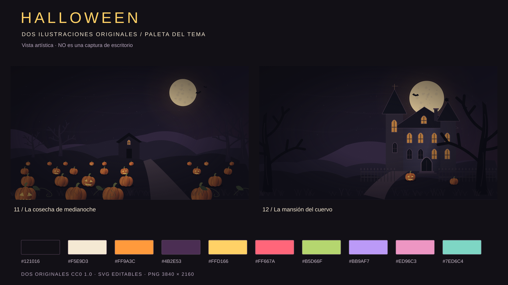
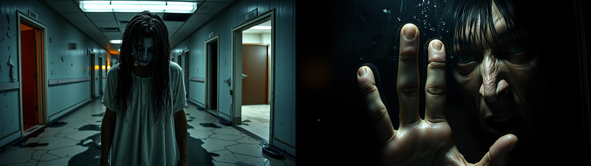

# Halloween for Omarchy

A dark Halloween theme: pumpkin orange, amethyst, ivory and potion green on near-black surfaces. **14 still wallpapers: 10 licensed third-party downloads + 4 wallpapers created for this project**. The four project-created wallpapers are **2 procedural vector illustrations at 4K (11–12)** and **2 FLUX-generated photographic-style horror scenes at native 2048 × 1152 (13–14)**.



Updated real desktop capture on **edge** with the **vivid ANSI palette**, unchanged **pumpkin-orange transparent bar**, **14-wallpaper collection** and **Don't Look at the Glass** background. Foot displays the actual generated orange, green, purple, red and cyan values; Neovim shows the real updated `colors.toml`. These are real application windows, not a montage. The wallpaper is fictional AI-generated artwork, not a photograph of a real person. [Earlier screenshot with Raven Manor](previews/desktop-mansion.png) · [Matching catalog WebP, 1200 × 675](previews/halloween.webp).

The capture predates the final registry cleanup: the four extra palette keys are no longer distributed, and Foot's normal ANSI magenta now uses the shared **`#E96AA9`** value. The shown wallpaper, orange bar and other generated colors are unchanged.

## Design and colors

`colors.toml` is the source of truth for the application palette. Omarchy generates configurations for terminals, Hyprland, Neovim, Helix, btop, browsers, editors and the shell from its templates. `shell.bar.toml` overrides only the bar's text color; the other shell surfaces keep their generated colors. Installed applications and local templates determine which integrations apply.

| Role | Color | Use |
| --- | --- | --- |
| Night | `#121016` | Main background |
| Void | `#08070C` | Deepest surface |
| Aubergine | `#251D2D` | Raised surfaces |
| Pumpkin | `#FF9A3C` | Unchanged bar text, accent, focus, actions and normal ANSI yellow |
| Border amethyst | `#BB9AF7` | Unchanged active-border endpoint |
| Ivory | `#F5E9D3` | Main text |
| Bone | `#FFF4DF` | Bright text and generated cursor |
| Gray lavender | `#9B8DA8` | Muted text |
| Plum | `#4B2E53` | Selection, with `#FFF4DF` text |
| Crimson | `#FF5263` | Errors and alerts |
| Potion | `#A8CF40` | Success and ANSI green |
| Flame | `#FFB05C` | Bright ANSI yellow, kept orange rather than cream |
| Blue moon | `#7F95F5` | ANSI blue |
| Spectral pink | `#E96AA9` | ANSI magenta in templates using the magenta token |
| Ectoplasm | `#3DCBB2` | ANSI cyan |

Active border: pumpkin → amethyst gradient at 45°. Inactive border: `#4B3A55`. The gradient is a color declaration, not an animation. Bright ANSI colors are defined separately. `icons.theme` selects **Yaru**, the orange variant available by default according to the manual.

The application palette now uses stronger, less pastel colored accents. Both normal and bright ANSI yellow stay pumpkin-orange; the top bar's **base setting** remains exactly `#FF9A3C`, with its native transparency and automatic contrast behavior preserved. Main ivory text, dark surfaces, selection and border colors are unchanged. Terminals receive these colors through Omarchy's normal generated templates, without global template overrides. Alacritty can reload the generated palette; open a new Foot window to use it. Wallpaper artwork, vector-art previews and the earlier Raven Manor screenshot retain their original artistic colors; no wallpaper was recolored. The main desktop preview now shows the revised application palette.

The clock and theme-aware monochrome bar icons use **pumpkin orange `#FF9A3C`** through the native `shell.bar.toml` section override. Application and popup text remains ivory; full-color application/tray icons retain their own artwork.

The normal transparency toggle is preserved. In transparent mode, **Omarchy's automatic contrast adjustment can replace orange with a dark color** when the sampled wallpaper strip is bright, including **The Last Corridor**. This theme does not disable that adjustment or force the bar to stay transparent. Orange is the base color, not a fixed-color guarantee over every wallpaper or window.

Contrast ratios calculated using sRGB relative luminance (WCAG): text/background **15.73:1**, muted/background **6.09:1**, accent/background **8.94:1**, selection **10.61:1**. These compare solid colors: they do not certify text over every part of an image or every application's transparency settings.

## Installable layout

The repository root is the theme root, without an additional enclosing directory:

```text
omarchy-theme-halloween-theme/
├── colors.toml              # Semantic palette
├── icons.theme              # Yaru
├── shell.bar.toml           # Pumpkin-orange bar text; native contrast behavior retained
├── backgrounds/             # 10 downloads + 2 4K vector illustrations + 2 2K AI images
├── optional/                # Opt-in animated wallpaper; excluded from the default set
├── artwork/                 # SVG sources for the original vector illustrations
├── preview.png              # Real desktop screenshot, 16:9
├── previews/                # Second screenshot, WebP, artwork and contact sheets
├── LICENSE                  # MIT: configuration and documentation
├── ARTWORK-LICENSE          # CC0 dedication: four project-created works and listed derivatives
├── SOURCES.md               # Author, source and license for each download
├── sources/                 # Provenance metadata
└── README.md
```

All fourteen final files are in `backgrounds/`: thumbnails and source files do not appear in the wallpaper selector. Downloads retain their source resolution, without artificial upscaling. See [`SOURCES.md`](SOURCES.md) for titles, authors, dimensions and licenses, and [`previews/contact-sheet.png`](previews/contact-sheet.png) to view the collection.

## Four project-created wallpapers (11–14)

The project-created collection contains **four still wallpapers**, grouped by how they were made. The ten downloaded photographs are separate and retain their own licenses.

### Vector illustrations (11–12)

Files **11** and **12** are the project's own procedural creations, not downloads or recolored photographs. Their editable SVG sources are in `artwork/`, and their final PNGs are **3840 × 2160 pixels**. [`previews/originals-contact-sheet.png`](previews/originals-contact-sheet.png) shows only these two works; [`previews/theme-art-preview.png`](previews/theme-art-preview.png) keeps their artistic presentation separate from the real screenshots.

- **11 — Midnight Pumpkin Harvest:** a nighttime harvest, candlelight and Halloween silhouettes.
- **12 — Raven Manor:** haunted architecture, warm windows and an amethyst sky.

### FLUX-generated horror scenes (13–14)

Wallpapers **13 and 14** use a photographic rather than cartoon style. They were **generated with FLUX.1 [schnell]**, depicting unsettling faces, damp surfaces, decay and cold lighting. These are fictional scenes created for the theme: **not photographs of real people** or output from the SVG generator.

- **[13 — The Last Corridor](backgrounds/13-the-last-corridor.webp):** a dark-eyed presence with wet hair in an abandoned corridor, with fluorescent lighting and floor reflections.
- **[14 — Don't Look at the Glass](backgrounds/14-dont-look-at-the-glass.webp):** a threatening face beside wet glass, with a hand in the foreground.

Both FLUX-generated scenes are included as **original WebP files, 2048 × 1152, 16:9**, without artificial upscaling, retouching or recomposition. Together with the two vector illustrations, they make up the **four project-created wallpapers**; all ten downloaded photographs remain included.



They were generated using the [official public Black Forest Labs Space](https://huggingface.co/spaces/black-forest-labs/FLUX.1-schnell). Full prompts, seeds, model version, parameters and SHA-256 hashes are in [`sources/13-14-generated.json`](sources/13-14-generated.json). Installing or using the included wallpapers requires no connection, account, generator or model.

Apache-2.0 licenses the **model**; it is not presented as a guarantee of exclusive rights over its outputs. The project's contribution to these images is dedicated under CC0 to the extent rights exist; see `ARTWORK-LICENSE`.

### Editable vector sources

The original SVGs for **11 and 12** remain in `artwork/`, alongside their existing **3840 × 2160** PNG exports in `backgrounds/`. They can be edited with an SVG-capable illustration tool. Their artistic previews and all four project-created stills remain unchanged.

The executable development renderer is no longer part of the installable theme, eliminating `NON_THEME_PAYLOAD`. Its MIT-licensed source remains available in [the project history](https://github.com/PuroDelphi/omarchy-theme-halloween-theme/blob/b5ba2e7fd00ab0b6e7f209ffd90805a2634f931c/tools/render-wallpapers.py). Installing or using the theme requires no generator dependencies.

## Local installation

From this project's root:

```bash
mkdir -p "$HOME/.config/omarchy/themes"
ln -sT -- "$PWD" "$HOME/.config/omarchy/themes/theme-halloween"
omarchy theme set theme-halloween
```

If `~/.config/omarchy/themes/theme-halloween` already exists, `ln -sT` will not replace it: inspect that destination before continuing. The link lets you edit the project and reapply the theme without copying files. **The last command changes the active desktop.** No `sudo`, changes to `/usr/share/omarchy/` or session restart are needed.

To cycle through the fourteen wallpapers:

```bash
omarchy theme bg next
```

To switch back, consult `omarchy theme list` and apply your previous theme's name with `omarchy theme set`. Installing or creating this repository alone does not change your desktop.

## Installation from GitHub

```bash
omarchy theme install https://github.com/PuroDelphi/omarchy-theme-halloween-theme
```

This command downloads **and applies** the theme. To select it again:

```bash
omarchy theme set theme-halloween
```

The repository follows the recommended `omarchy-<name>-theme` convention. Omarchy strips the `omarchy-` prefix and `-theme` suffix, retaining the installed identifier **`theme-halloween`**. Existing theme and user-background folders therefore keep the same name.

## Optional animated edition

The **default edition** contains the fourteen still wallpapers above. The **animated edition** offers **three separate optional videos**: two takes of **13 — The Last Corridor** and one animation of **14 — Don't Look at the Glass**. Each is a **15.042-second, 24 fps, silent VP9 WebM with 361 frames**, at the source dimensions listed below. There is no executable installer, plugin, service or hook.

| Choice | File | Native resolution | Scene |
| --- | --- | --- | --- |
| First corridor clip | [`halloween-jumpscare.webm`](optional/halloween-jumpscare.webm) | 736 × 400 | Approaching figure, ending in a close-up scare with reaching hands and broken-glass imagery |
| Second corridor clip | [`the-last-corridor-2.webm`](optional/the-last-corridor-2.webm) | 736 × 400 | A separate take with spreading hair, changing facial expressions and an approaching figure |
| Glass / reflection clip | [`dont-look-at-the-glass.webm`](optional/dont-look-at-the-glass.webm) | 1280 × 720 | The figure behind wet glass moves its fingers, hand and face |

Each clip is an **additional choice**, not a replacement or a concatenation. Keep any combination and select the one you want.

**Native-resolution exports:** all three preserve the supplied clips' frames and dimensions, without upscaling, cropping, interpolation or added transitions. The two corridor clips will look softer at full-screen size than the 720p glass clip; none is presented as a seamless loop. The original source MP4s remain unchanged locally; their audio and attached cover images are excluded from the wallpaper exports.

**Generation credits:** the two corridor clips were **Created with Grok**, as confirmed by the repository owner. The generation tool for the supplied glass clip was not specified and is not inferred. Per-file provenance records distinguish them. Grok's [output-ownership guidance](https://x.ai/legal/faq#who-owns-the-inputs-to-and-outputs-from-grok) says users own their outputs and may use them commercially; its [brand guidelines](https://x.ai/legal/brand-guidelines) request this attribution. These are AI-generated fictional scenes, not real footage or provider endorsements. The owner's contributions to the three animations are licensed under **[CC BY 4.0](https://creativecommons.org/licenses/by/4.0/)**, to the extent applicable rights exist. Credit **PuroDelphi**, retain documented generation credits, link the license and identify modifications. See [provenance and rights](SOURCES.md#optional-animated-wallpaper).

**Compatibility requirement:** use an Omarchy build with native **OWE video wallpaper support**, as documented in the [official background manual](https://github.com/omacom/omarchy/blob/quattro/manual/39-backgrounds.md). The tested stable **4.0.5-1** build cannot play this edition. Development builds on the **edge** channel include video support; the feature is tracked under the [4.5 milestone](https://github.com/omacom/omarchy/pull/6792). **Switching channels updates the system, not just the wallpaper, and development builds can break.** See the [official channel guidance](https://github.com/omacom/omarchy/blob/quattro/manual/30-updates.md). An experimental channel is not required for the static theme.

All clips deliberately live **outside `backgrounds/`**. Installing the theme does not enable them or add them to the wallpaper cycle. A marketplace install may omit `optional/` entirely; download the chosen media explicitly using the instructions below.

### Enable

**Only users who want animation need to opt in.** Installing Halloween does not activate any video. With a compatible Omarchy build and **Halloween installed and selected**, download and select a silent WebM once. The examples below select the **glass clip**; set `clip` to another filename from the table to choose either corridor clip.

```bash
clip="dont-look-at-the-glass.webm"
video="$HOME/.config/omarchy/backgrounds/theme-halloween/$clip"
mkdir -p "$HOME/.config/omarchy/backgrounds/theme-halloween" &&
  curl --fail --location --output "$video" \
    "https://raw.githubusercontent.com/PuroDelphi/omarchy-theme-halloween-theme/main/optional/$clip" &&
  omarchy theme bg set "$video"
```

If you already cloned this repository, you can copy the selected file instead of downloading it. Run this alternative **from the repository root**:

```bash
clip="dont-look-at-the-glass.webm"
video="$HOME/.config/omarchy/backgrounds/theme-halloween/$clip"
mkdir -p "$HOME/.config/omarchy/backgrounds/theme-halloween" &&
  cp "optional/$clip" "$video" &&
  omarchy theme bg set "$video"
```

Use the exported **`.webm` files**, not the original source MP4s, which retain their audio. Once copied to the user background folder, the clips can be selected with **`Super + Ctrl + Space`** whenever you want them; you do not need to rerun the download or copy command.

**The last command immediately selects the animated wallpaper.** After installation, it also appears in the normal background picker/cycle. The effect stays behind application windows; it is not an on-top popup. Omarchy may preserve the selected wallpaper across logins and also display its video on the lock screen, depending on the version. Video consumes more power than a still; consumption has not been measured here.

### Stop playback and keep the video

Choose a still image with **`Super + Ctrl + Space`**, or return directly to the original corridor image:

```bash
omarchy theme bg set \
  "$HOME/.config/omarchy/themes/theme-halloween/backgrounds/13-the-last-corridor.webp"
```

Selecting a still stops video playback without changing the theme or deleting the optional files. Copied videos remain available in the picker for later use.

The fourteen default wallpapers remain installed. No daemon, plugin, configuration entry or autostart needs removing.

### Remove the optional videos

After selecting a still as shown above, remove any optional copies you no longer want offered when cycling backgrounds. This example removes all three entries:

```bash
rm -f -- "$HOME/.config/omarchy/backgrounds/theme-halloween/halloween-jumpscare.webm" \
  "$HOME/.config/omarchy/backgrounds/theme-halloween/the-last-corridor-2.webm" \
  "$HOME/.config/omarchy/backgrounds/theme-halloween/dont-look-at-the-glass.webm"
```

### Listing policy

The [theme registry](https://github.com/omacom/omarchy-theme-registry#what-gets-checked) recognizes video backgrounds. Its [validator](https://github.com/omacom/omarchy-theme-registry/blob/master/packages/validator/src/validate.ts) issues a `BACKGROUND_VIDEO` resource warning for videos under `backgrounds/`, not an automatic rejection. These opt-in assets are outside that directory and need no executable code. **Neither the manual nor the validator guarantees maintainer approval or inclusion among Omarchy's bundled themes.**

Source hashes, export commands and artwork rights are documented in [`sources/optional-jumpscare.json`](sources/optional-jumpscare.json), [`sources/optional-corridor-2.json`](sources/optional-corridor-2.json), [`sources/optional-glass.json`](sources/optional-glass.json), [`SOURCES.md`](SOURCES.md) and [`ARTWORK-LICENSE`](ARTWORK-LICENSE).


## Distribution and approval

1. Distribution repository: **[PuroDelphi/omarchy-theme-halloween-theme](https://github.com/PuroDelphi/omarchy-theme-halloween-theme)**. Its root directly contains the palette and `backgrounds/`.
2. Check installation from that URL using **Install → Style → Theme** or the command above. The resulting identifier should be `theme-halloween`.
3. `preview.png` contains a real screenshot with a terminal and Neovim; `previews/desktop-mansion.png` shows a second scene. They were reviewed before publication to exclude private windows, usernames, notifications and the mouse pointer.
4. Website catalog submission: **[omacom/omarchy-site#586](https://github.com/omacom/omarchy-site/pull/586)**, with the required WebP screenshot and alphabetical entry.

**Installable ≠ accepted into the catalog ≠ bundled by default.** The manual provides a community-theme catalog route; it does not promise to make a submission an official distribution theme. Acceptance is up to the maintainers. Publishing on GitHub does not itself mean a catalog submission has been made or approved.

The theme uses the semantic format of the reference installation, **Omarchy 4.0.5-1**. Compatibility with earlier editions using other configuration formats is not guaranteed.

### Community submissions

- **Website catalog:** [PR #586](https://github.com/omacom/omarchy-site/pull/586). The submission locally passed build, lint, type checks, **51 Node + 45 Python tests**, static parity and visual browser inspection of the catalog. These local checks are not remote checks or maintainer approval.
- **Marketplace registry:** [submission #141](https://github.com/omacom/omarchy-theme-registry/issues/141), created through the official form with the `submission` label. The [remote revalidation on 2026-10-21](https://github.com/omacom/omarchy-theme-registry/issues/141#issuecomment-6322006657) **passed with zero errors and zero warnings** after the repository rename, palette cleanup, single-photo conversion and renderer removal. GitHub recognizes the root software license as **MIT**. The existing [registry PR #142](https://github.com/omacom/omarchy-theme-registry/pull/142) retains `submission` and `auto-approve` labels; it still requires a maintainer to merge it before marketplace publication. The superseded [submission #128](https://github.com/omacom/omarchy-theme-registry/issues/128) remains closed with a replacement link.
- Both submissions describe the theme's included content. Follow their links for the maintainers' current decisions; submission does not imply immediate catalog listing.

### Registry warning corrections

- **`REPO_NO_LICENSE`:** `LICENSE` contains the exact standard MIT text recognized by GitHub. Artwork notices remain in README and `ARTWORK-LICENSE`, including CC BY 4.0 grants for the owner's animation contributions and the unchanged source licenses for photographs.
- **`REPO_NAME_CONVENTION`:** the approved repository name is now `omarchy-theme-halloween-theme`; the validated install slug remains `theme-halloween`.
- **`PALETTE_UNKNOWN_KEYS`:** removed `selection_background`, `selection_foreground`, `purple` and `bright_purple`. Omarchy derives selection colors from `selection` / `bright_foreground` and legacy purple aliases from the existing magenta values.
- **`BACKGROUNDS_LARGE`:** re-encoded only the largest CC0 photograph, **05 — Pumpkin and Spider**, as WebP quality **82**, retaining **4961 × 3508** pixels. The collection is now **20.37 MiB**, below 25 MiB. The other thirteen stills, including all four project-created wallpapers, remain byte-identical.
- **`NON_THEME_PAYLOAD`:** removed the executable renderer from the current theme tree. Editable SVG artwork remains included; the former renderer is available only through project history.

### Website catalog: specific requirements

According to the site's [“Adding your theme” instructions](https://github.com/omacom/omarchy-site#adding-your-theme), the PR must include:

- A **real 16:9 screenshot** showing a terminal, editor and a theme wallpaper, without a cursor, notifications or private information. An illustration or empty desktop is not a substitute.
- That screenshot converted to WebP at `assets/themes/halloween.webp`, targeting **1200 × 675** and approximately **under 100 KB**, without upscaling a small screenshot.
- A `<figure class="themes__theme">` block in **`themes/index.html`**, in alphabetical order. Both image and title must link to `https://github.com/PuroDelphi/omarchy-theme-halloween-theme`.

The site generates its data from that HTML: do not edit `src/data/themes.json` as the submission source. A PR without a screenshot cannot be merged. `previews/halloween.webp` is the refreshed real screenshot prepared for this submission: **1200 × 675, quality 80, 50,808 bytes**. The separate artistic preview must not be confused with the screenshot.

### Marketplace: a separate registration route

[themes.omarchy.org](https://themes.omarchy.org) also has its [own registry and instructions](https://github.com/omacom/omarchy-theme-registry). Its [Submit a theme](https://github.com/omacom/omarchy-theme-registry/issues/new?template=submit-theme.yml) form requests the URL, allows **Halloween** as the display name and requires confirmation of authorship/permissions and absence of private data. The bot validates and proposes a PR; the final decision remains with a maintainer.

The registry requires the palette and wallpapers at the theme root and a 16:9 `preview.png` at least 1000 pixels wide. It rejects symbolic links, images larger than 50 MB or 40 megapixels, and repositories larger than 400 MB, among other errors. README, LICENSE and the `omarchy-theme` topic are recommended. An unconventional repository name and generation tools may produce **warnings**, not necessarily errors. The local installation symlink is not part of the repository or its download.

The registry may assign a different identifier if the name is already taken. Installation by name/validated commit belongs to that system; the verified local installation uses the **full Git URL**, without assuming `omarchy theme install halloween` is available.

### Bundling by default

Bundled themes are in `themes/` in the [Omarchy project](https://github.com/omacom/omarchy). No specific policy was found guaranteeing acceptance of a new theme into that collection. The project directs suggestions to [Discussions](https://github.com/omacom/omarchy/discussions), rather than bug issues. Publication and community catalogs do not imply inclusion in the distribution.

### What a downloaded theme should not need

In the version consulted, a theme cloned with `omarchy theme install` cannot supply Lua, terminal configurations (`alacritty.toml`, `foot.ini`, `ghostty.conf`, `kitty.conf`) or `vscode.json`: Omarchy excludes them from staging and regenerates them from the palette. They are not included here. There is also no executable installer, autostart hook or mandatory extension.

## Verification performed

Initial validation environment: **stable Omarchy 4.0.5-1**, as reported by the installed package. The initial collection was tested in a real graphical session; the expansion to 14 wallpapers was additionally checked with an isolated installation. The current primary preview and vivid ANSI revision were captured and checked on **edge, Omarchy 4.0.0.r7080.g60f5b49-1**.

- Full decoding of all **14 wallpapers**, dimension checks and absence of binary duplicates: passed.
- **10 downloads** at their source resolution, between 3264 and 6000 pixels wide; **2 vector illustrations** at 3840 × 2160 and **2 AI-generated horror images** at native 2048 × 1152, without upscaling. The last two images' hashes match the generation record.
- Actual generator execution for scene 11 at **1920 × 1080** in a temporary directory: passed.
- Actual installation with `omarchy theme install` from a temporary Git repository containing the project, using **isolated HOME and XDG paths** and `OMARCHY_THEME_HEADLESS=1`: exit 0, identifier **`theme-halloween`** and all **14 wallpapers available**, including both new WebPs intact. It did not change the active desktop.
- During the initial installation: **19 configurations** generated by the installed templates, without unresolved variables; JSON/TOML outputs parsed successfully.
- `foot --check-config` on its generated configuration: exit **0**.
- Visual review of the two vector illustrations, the two AI-generated horror images and the **fourteen-wallpaper** contact sheet.
- Installation from the public URL and actual application in Hyprland: **Theme Halloween**; `hyprctl configerrors` reported no errors. The refreshed primary screenshot on edge shows **Don't Look at the Glass**, the unchanged orange transparent bar, Neovim displaying the actual revised `colors.toml`, and a Foot terminal displaying the installed development version, fourteen-wallpaper count and generated vivid palette values.
- Real visual inspection of **Foot, Neovim, borders and wallpaper**, with two desktop screenshots. Not all other applications have been visually tested.
- Screenshots came from the native **1366 × 768** monitor, minimally cropped by 3 pixels on each side and 1/2 pixels at the top/bottom to **1360 × 765**, without upscaling or distortion. The current WebP was reduced to **1200 × 675**, quality **80**, stripped metadata, **51,702 bytes**.
- English filename migration, local Markdown link targets and AI-image provenance hashes: checked. The translated renderer generated scene 11 successfully at 1920 × 1080.
- Repeated the isolated Omarchy installation after the English cutover: **14 still wallpapers**, with no optional video in the default background cycle or selected as the active background.
- First optional WebM (`halloween-jumpscare.webm`): all **361 frames** decoded, **736 × 400 / 24 fps / 15.042 seconds**, one VP9 video stream and **no audio**. A complete FFplay playback run with SDL's dummy output exited successfully, and sampled frames were visually reviewed. The supplied MP4 and all fourteen still wallpapers remain unchanged. Native OWE wallpaper playback was **not** tested on the installed stable build.
- Second optional WebM (`the-last-corridor-2.webm`): all **361 frames** decoded, **736 × 400 / 24 fps / 15.042 seconds**, one VP9 stream and **no audio**. Full FFplay playback with SDL's dummy output exited **0**, and sampled frames were visually reviewed. README Bash examples passed syntax checks; the documented copy command copied the exact second clip in an isolated HOME without executing wallpaper selection. Source MP4 hashes, the first video, all fourteen stills, the vivid palette, bar override and desktop previews were preserved. The second clip was not enabled automatically.
- Third optional WebM (`dont-look-at-the-glass.webm`): all **361 frames** decoded, **1280 × 720 / 24 fps / 15.042 seconds**, one VP9 stream and **no audio**. Full FFplay playback with SDL's dummy output exited **0**, and sampled source/export frames were visually reviewed. README Bash examples passed syntax checks; an isolated-HOME copy reproduced the exact new WebM hash without changing the selected wallpaper. The original source MP4s, both prior videos, all fourteen stills and desktop previews were preserved.
- Licensing: the root MIT text matched GitHub's official template exactly, with the existing copyright holder substituted. All three optional-video provenance records parse and match the distributed media hashes, native dimensions, frame counts and explicit CC BY 4.0 grants for the owner's contributions. Required photograph credits and the qualified original-art dedication remain bundled in README for selective installers.
- Earlier local runs of the official registry's `validateTheme` implementation passed with zero errors and advisories for the repository name, palette schema, still-collection size and optional renderer. Optional clips remain outside `backgrounds/`. See [community submissions](#community-submissions) for the actual remote report; local checks are not maintainer approval.
- Bar-only orange override: installed through the real Omarchy installer in an isolated HOME, confirming orange bar text with unchanged application, popup and control colors. Applied to the live desktop without changing the wallpaper or `shell.json`; the clock and monochrome icons were visually checked with transparency enabled. The native contrast helper kept orange for 13 of the 14 supplied wallpapers at a 1920 × 1080 top-bar sample and chose dark text for **The Last Corridor**, consistent with the retained automatic behavior.
- Vivid ANSI revision on **edge**: ran the real Omarchy template generator in an isolated HOME and passed `foot --check-config`. Applied the palette with `omarchy theme refresh` and visually inspected native ANSI output in a real Alacritty window: normal yellow is **`#FF9A3C`**, bright yellow is **`#FFB05C`**, and the other colored accents are stronger rather than near-white pastels. The revised colored accents have at least **5.64:1** contrast against the solid `#121016` background. The bar section, global `shell.json` and selected wallpaper remained unchanged. The temporary comparison window and private captures were removed; the user's windows were preserved.
- Registry-warning cleanup: native template generation in isolated homes produced **20 configurations** before and after removing the four extra palette keys. **19 were byte-identical**; Foot's normal ANSI magenta changed from the former `purple` override to the shared canonical `magenta` value, **`#E96AA9`**. `foot --check-config` passed. Selection colors, orange ANSI yellow, bar text and all other generated settings were preserved.
- Compression review: photograph 05 was decoded at its original **4961 × 3508** dimensions and compared visually before/after at full-scene and native-pixel scale. Only that CC0 photograph was re-encoded as WebP; the other thirteen wallpapers, all three optional videos and existing previews retain their bytes.
- After cleanup, a real `omarchy theme install` from the renamed public repository passed with isolated HOME/XDG paths and `OMARCHY_THEME_HEADLESS=1`: identifier **`theme-halloween`**, all **14 still wallpapers** staged, the new WebP present, the obsolete JPEG absent and **no video** in the default background set. The installed Foot configuration passed `foot --check-config`. The user's desktop and selected wallpaper were not changed.

The fourteen wallpapers total **20.37 MiB**, below the registry's advisory 25 MiB threshold. Only photograph 05 was re-encoded, without resizing; the other thirteen files retain their original bytes. Every image remains within the hard limits of 50 MB and 40 megapixels. A community submission does not imply acceptance or bundling by default.

## Primary sources

- [Manual: making and distributing a theme](https://omarchy.org/manual/making-your-own-theme/).
- [Community theme catalog](https://omarchy.org/themes/).
- [Omarchy repository](https://github.com/omacom/omarchy): `omarchy-theme-install`, `omarchy-theme-set`, `omarchy-theme-set-templates` and `omarchy-theme-color` commands.
- [Website repository](https://github.com/omacom/omarchy-site): catalog contribution route. The manual may retain links using an older organization name; the catalog links to `omacom`.
- [Exact catalog instructions](https://github.com/omacom/omarchy-site#adding-your-theme) and [marketplace registry](https://github.com/omacom/omarchy-theme-registry).

## Licensing and provenance

The **14 still wallpapers** consist of **10 third-party downloads and 4 project-created works (11–14)**. The four project-created works are grouped below by provenance and licensing:

| Group | Files | License / dedication |
| --- | --- | --- |
| 2 procedural vector illustrations | 11–12, their SVG sources and vector previews | [CC0 1.0 Universal](ARTWORK-LICENSE) |
| 2 FLUX-generated horror scenes | 13–14 and their comparison preview | Project contribution dedicated under [CC0 only to the extent applicable rights exist](ARTWORK-LICENSE), without a promise of exclusivity or copyright protection |
| 10 downloaded photographs | 01–10 and their thumbnails | Their individual source licenses and attribution in [SOURCES.md](SOURCES.md); **not relicensed by the project** |

**Configuration, tools and documentation use [MIT](LICENSE).** The root `LICENSE` contains only the standard MIT text so automated services can recognize it. The repository's media are separately licensed; the MIT label does **not** relicense third-party photographs or their thumbnails.

The owner's contributions to the **three optional animation derivatives** are licensed under **[CC BY 4.0](https://creativecommons.org/licenses/by/4.0/)**, to the extent applicable rights exist, without a promise of exclusivity or copyright protection. Credit **PuroDelphi**, retain the documented generation credits, link the license and indicate modifications. The two corridor clips were **Created with Grok**; the glass clip's generation tool was not specified. The underlying stills retain their qualified CC0 dedication. No third-party rights or provider conditions are waived. Contact sheets are presentations of existing works, not additional wallpapers or waivers of the depicted works' rights. Installing the theme does not run generators or require their dependencies.

Mandatory wallpaper attribution, license links and the dedication of the four project-created works are bundled below so they accompany the wallpapers even if a selective installer copies only `README.md` and `LICENSE`, not `SOURCES.md` or `ARTWORK-LICENSE`.

### Bundled wallpaper notices

Nine downloaded photographs are distributed **without modifications**; photograph **05** is re-encoded as WebP quality **82** at its original dimensions, with metadata stripped. Contact-sheet thumbnails are reduced and labelled; each retains its source license. No author or source endorses this theme.

| File | Work / author or source credit | Source | License |
| --- | --- | --- | --- |
| `01-jack-o-lantern.jpg` | Halloween lanterns — CC0-Photographers / PxHere; individual author unidentified | [PxHere 783593](https://pxhere.com/en/photo/783593) | [CC0 1.0](https://creativecommons.org/publicdomain/zero/1.0/) |
| `02-pumpkin-row.jpg` | Row of carved pumpkins — CC0-Photographers / PxHere; individual author unidentified | [PxHere 1392093](https://pxhere.com/en/photo/1392093) | [CC0 1.0](https://creativecommons.org/publicdomain/zero/1.0/) |
| `03-candlelit-grin.jpg` | Illuminated pumpkin — CC0-Photographers / PxHere; individual author unidentified | [PxHere 334524](https://pxhere.com/en/photo/334524) | [CC0 1.0](https://creativecommons.org/publicdomain/zero/1.0/) |
| `04-pumpkin-and-lantern.jpg` | Pumpkin and lantern — CC0-Photographers / PxHere; individual author unidentified | [PxHere 774668](https://pxhere.com/en/photo/774668) | [CC0 1.0](https://creativecommons.org/publicdomain/zero/1.0/) |
| `05-pumpkin-and-spider.webp` | Pumpkin and spider on wood — Dorothe / PxHere; re-encoded as WebP without resizing | [PxHere 1453995](https://pxhere.com/en/photo/1453995) | [CC0 1.0](https://creativecommons.org/publicdomain/zero/1.0/) |
| `06-graveyard-of-lights.jpg` | *Halloween lights and decorations at night along Seven Oaks Lane, Ewing Township, New Jersey, 2023-10-01* — [Famartin](https://commons.wikimedia.org/wiki/User:Famartin) | [Wikimedia Commons](https://commons.wikimedia.org/wiki/File:2023-10-01_21_08_14_Halloween_lights_and_decorations_at_night_along_Seven_Oaks_Lane_in_the_Mountainview_section_of_Ewing_Township,_Mercer_County,_New_Jersey.jpg) | [CC BY-SA 4.0](https://creativecommons.org/licenses/by-sa/4.0/) |
| `07-purple-ghosts.jpg` | *Halloween lights and decorations at night along Windybush Way, Ewing Township, New Jersey, 2023-10-27* — [Famartin](https://commons.wikimedia.org/wiki/User:Famartin) | [Wikimedia Commons](https://commons.wikimedia.org/wiki/File:2023-10-27_20_05_48_Halloween_lights_and_decorations_at_night_along_Windybush_Way_in_the_Mountainview_section_of_Ewing_Township,_Mercer_County,_New_Jersey.jpg) | [CC BY-SA 4.0](https://creativecommons.org/licenses/by-sa/4.0/) |
| `08-halloween-at-tivoli.jpg` | *Copenhagen 2014-10-24 — Halloween i Tivoli* — [Guillaume Baviere](https://www.flickr.com/people/84554176@N00) | [Flickr](https://www.flickr.com/photos/84554176@N00/15526730307/) | [CC BY-SA 2.0](https://creativecommons.org/licenses/by-sa/2.0/) |
| `09-red-eyed-skull.jpg` | Decorative Halloween skull — unidentified individual author / PxHere | [PxHere 784164](https://pxhere.com/en/photo/784164) | [CC0 1.0](https://creativecommons.org/publicdomain/zero/1.0/) |
| `10-ghost-circle.jpg` | *Ghostly Circle (2005-10-22)* — [Kate Mereand-Sinha](https://www.flickr.com/people/61404403@N00) | [Flickr](https://www.flickr.com/photos/katmere/57310994/) | [CC BY 2.0](https://creativecommons.org/licenses/by/2.0/) |

`CC0-Photographers` is a source profile name, not a verified individual author. CC BY requires credit, a license link and notice of changes. CC BY-SA additionally requires distributed adaptations to use the applicable ShareAlike terms. No additional restrictions are imposed on these licensed photographs.

**Project-created artwork dedication:** the two vector illustrations (11–12), their SVG sources and vector previews are dedicated under [CC0 1.0 Universal](https://creativecommons.org/publicdomain/zero/1.0/legalcode). The project's contribution to the two fictional FLUX-generated stills (13–14) and their comparison preview has the same dedication only to the extent applicable rights exist, without a promise of exclusivity, copyright protection or warranty. This does not cover the downloaded photographs or optional animation contributions licensed separately above.

**Desktop screenshots:** the capture contribution in `preview.png`, `previews/halloween.webp` and `previews/desktop-mansion.png` is MIT. Depicted software and wallpaper artwork retain their own rights. The first two show AI-generated still 14; the mansion capture shows vector still 12. A screenshot or combined contact sheet does not waive the depicted works' rights.
